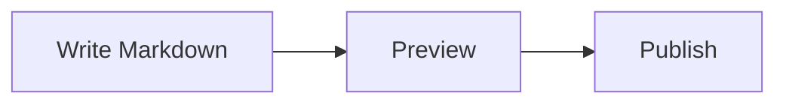

All fence options are optional. These examples show each one separately before
combining them.

## Plain code

````md
```
Hello, RDX!
```
````

```
Hello, RDX!
```

The header uses the default code label. Add a language for highlighting:

````md
```tsx
export function Welcome() {
  return <h1>Hello, RDX!</h1>
}
```
````

```tsx
export function Welcome() {
  return <h1>Hello, RDX!</h1>
}
```

## Show a filename

Place `title="filename"` after the fence language:

````md
```ts title="rdx.config.ts"
const search = true
```
````

```ts title="rdx.config.ts"
const search = true
```

The title appears in the header; copying keeps only the code. Titles with spaces
use quotes, such as `title="Install dependencies"`.

## Number lines

Add only `lineNumbers` to start at 1, with no title or custom starting value:

````md
```tsx lineNumbers
export function Welcome() {
  return <h1>Hello, RDX!</h1>
}
```
````

```tsx lineNumbers
export function Welcome() {
  return <h1>Hello, RDX!</h1>
}
```

Omit the flag to keep numbers hidden. Copying excludes the line numbers.

## Set the starting line

Use `startLine` alongside `lineNumbers` for a fragment of a larger file:

````md
```ts lineNumbers startLine=20
const enabled = true
console.log(enabled)
```
````

```ts lineNumbers startLine=20
const enabled = true
console.log(enabled)
```

`startLine` is a positive integer. Omit it to start at 1. It sets the starting
value without enabling numbering by itself.

## Combine options

Add a title when a filename helps explain the fragment:

````md
```ts title="example.ts" lineNumbers startLine=20
const enabled = true
console.log(enabled)
```
````

```ts title="example.ts" lineNumbers startLine=20
const enabled = true
console.log(enabled)
```

## Long blocks on mobile

On screens narrower than 768px, blocks taller than about 12 visible lines show
an automatic preview. Use **Show more** to expand and **Show less** to collapse.
Short blocks and desktop views remain fully visible. Copying always includes
the complete block, including content outside the preview.

## Compare changes

Use a `diff` fence. Prefix removed lines with `-`, added lines with `+`,
and unchanged lines with a space. The copy button copies the patch as shown.

```diff
-const search = false
+const search = true
 console.log(search)
```

## Mermaid diagrams

Use a `mermaid` fence to render a diagram. The header can show an optional title,
copy the definition, switch between diagram and source, or open a larger view:



See [Diagrams](./diagrams.mdx) for syntax examples and accessibility.

## Draw a folder tree

Use a `folder` fence with two spaces per level. End folder names with `/`.
The diagram's branches are generated from those indents.

```folder
my-docs/
  docs/
    guides/
      introduction.mdx
  public/
    images/
      logo.svg
  components/
    home.tsx
  rdx.config.ts
```

Folder names ending in `/` receive a folder icon. File icons follow their
extension, with a generic file icon for other names.

## Type ASCII branches

Use `|-` for `├──`, `|_` for `└──`, and `|` for `│` in the tree prefixes:

````md
```folder title="Project files"
my-docs/
|- docs/
|   |_ intro.mdx
|- package.json
|_ logo.svg
```
````

```folder title="Project files"
my-docs/
|- docs/
|   |_ intro.mdx
|- package.json
|_ logo.svg
```

Leave a space between each branch marker and the name. Existing Unicode trees
also work. Copying produces the text diagram without icons; a `text` fence
preserves the original ASCII characters. Long lines scroll inside the block.
