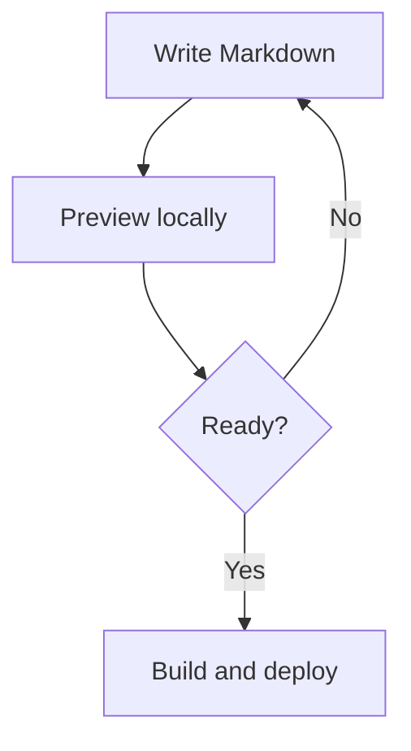
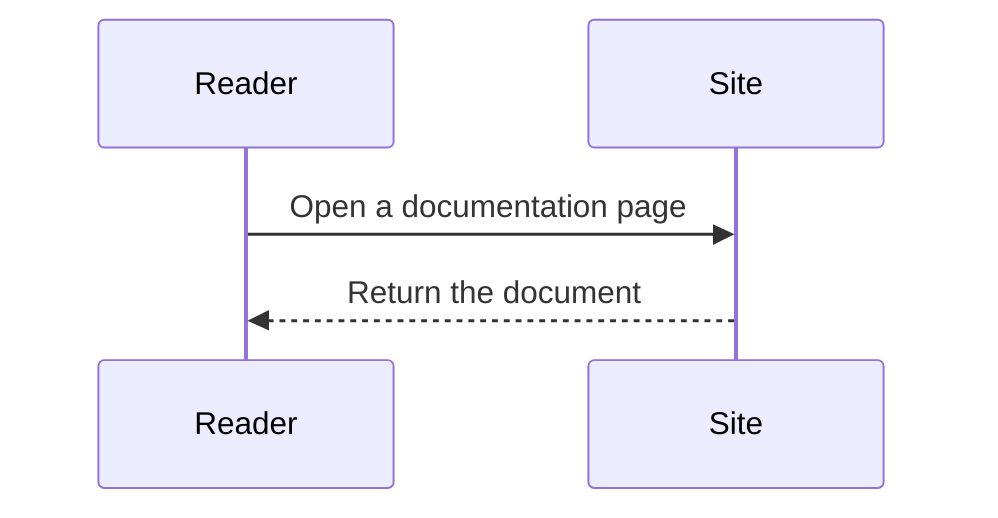
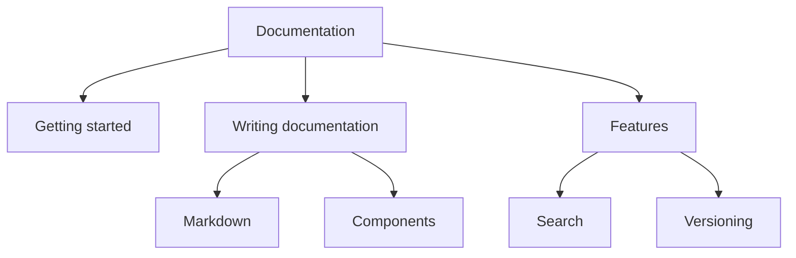

## Write a diagram

Use a fenced code block with `mermaid` as its language. RDX renders the diagram
inside the shared code-block frame:

````md

````


No import or plugin is required. The `title` is optional. Diagram colors follow
the site's light or dark theme.

## Explore and copy

Use the header buttons to show the diagram's source, return to the diagram,
open a larger view, or copy the original Mermaid definition. The larger view
scrolls when a diagram exceeds the screen. Press Escape to close it and return
to the expand button.

The source view also supports the optional `lineNumbers` and `startLine` fence
options. On mobile, use its wrap-lines button for long definitions.

Mermaid loads when a diagram block approaches the visible area. Rendering runs
in the browser; before it finishes, or with JavaScript disabled, the definition
remains readable. If a definition is invalid, the block displays a message and
keeps its source available. Keep definitions within 50,000 characters and
flowcharts within 500 edges.

## Sequence diagrams

Mermaid supports different diagram types through the same fence. For example:



````md

````

Use Mermaid's `accTitle` and `accDescr` to describe your diagram for screen
readers. A fence `title` supplies the image's accessible name when present,
followed by `accDescr` when provided.

## Tree-shaped flows

Use branches to describe a process or a hierarchy:



For directory structures, use a [folder code block](./code-blocks.mdx#draw-a-folder-tree).
For more diagram types and syntax, see the [Mermaid documentation](https://mermaid.js.org/intro/).
