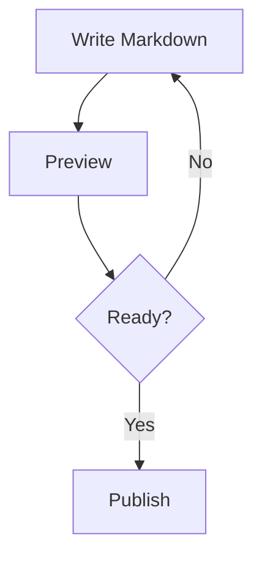
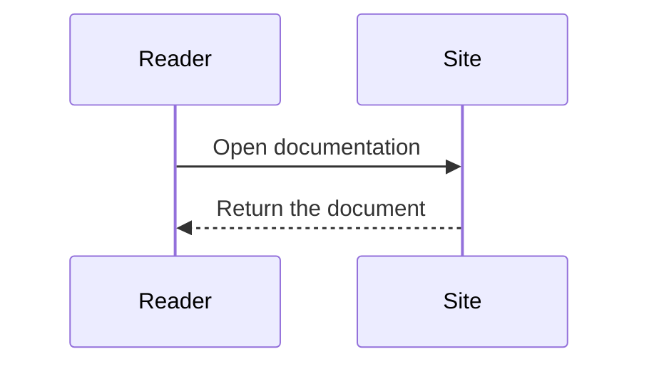
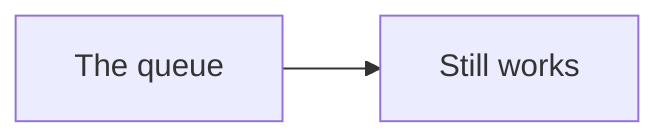
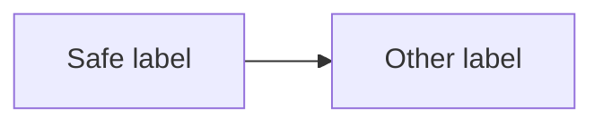
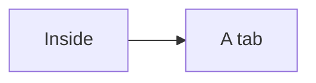

## Flow



## Sequence



## Invalid source

```mermaid title="Invalid definition"
this is not a Mermaid diagram
```

## Recovery



## Strict rendering



## Diagram in a tab

:::tabs

### Overview

Choose the diagram tab to render its content.

### Diagram example



:::
